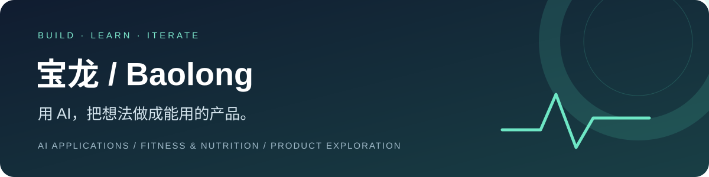

  

  <a href="#正在做的项目">项目</a> · <a href="#我关心什么">关注方向</a> · <a href="#一起交流">交流</a>

你好，我是 **宝龙（Baolong）**。我正在学习并实践 AI 应用开发：从一个具体需求出发，借助 AI 编程工具与开源项目做原型，再通过实际试用持续改进。

目前主要探索 **健身、饮食记录与 AI 陪伴**。希望工具既能帮人完成事情，也能让使用过程轻松一点。

## 正在做的项目

| 项目 | 想解决的问题 | 我的改动与当前阶段 |
| :--- | :--- | :--- |
| **[MyPT · AI 健身饮食管家](https://github.com/baolongyuan088-boop/MyPT)** | 吃什么、怎么练，以及状态不好时如何获得合适的支持 | 中文界面、模型接口接入、对话语气与情绪支持、邀请码内测。已部署页面，完整内测流程仍在完善。 |
| **[FitPilot · 轻燃](https://github.com/baolongyuan088-boop/FitPilot)** | 把训练记录、进度和饮食管理放在一起 | 中文默认配置、轻燃品牌、饮食记录与统计、按食物份量换算营养、AI 连接流程。当前可本地运行，线上部署筹备中。 |

> 两个项目都基于开源作品继续开发。MyPT 源自 [system-conf/MyPT](https://github.com/system-conf/MyPT)，FitPilot 源自 [DuarteSantos8/openGym](https://github.com/DuarteSantos8/openGym)。保留原作者署名与许可证；第三方图片、动画等素材的授权单独处理。

## 我关心什么

- **有用的 AI**：结合真实记录给建议，不把普通聊天变成填表。
- **自然的陪伴**：先理解感受，再提供选择；鼓励具体、有依据。
- **简单的体验**：少一些操作，让记录饮食和训练更容易开始。
- **真实的验证**：区分原型、已实现功能和实际可用的线上服务。

## 正在实践的技术

`Next.js` · `React` · `TypeScript / JavaScript` · `Node.js` · `PWA` · `OpenAI 兼容接口` · `Git / GitHub`

这些是项目中正在使用和学习的工具，项目说明与代码记录了具体实现。

## 一起交流

欢迎在项目的 **Issues** 中提出使用反馈或讨论产品想法：

- [给 MyPT 提建议](https://github.com/baolongyuan088-boop/MyPT/issues)
- [给 FitPilot 提建议](https://github.com/baolongyuan088-boop/FitPilot/issues)

---

从小问题开始，把每一次迭代做扎实。

